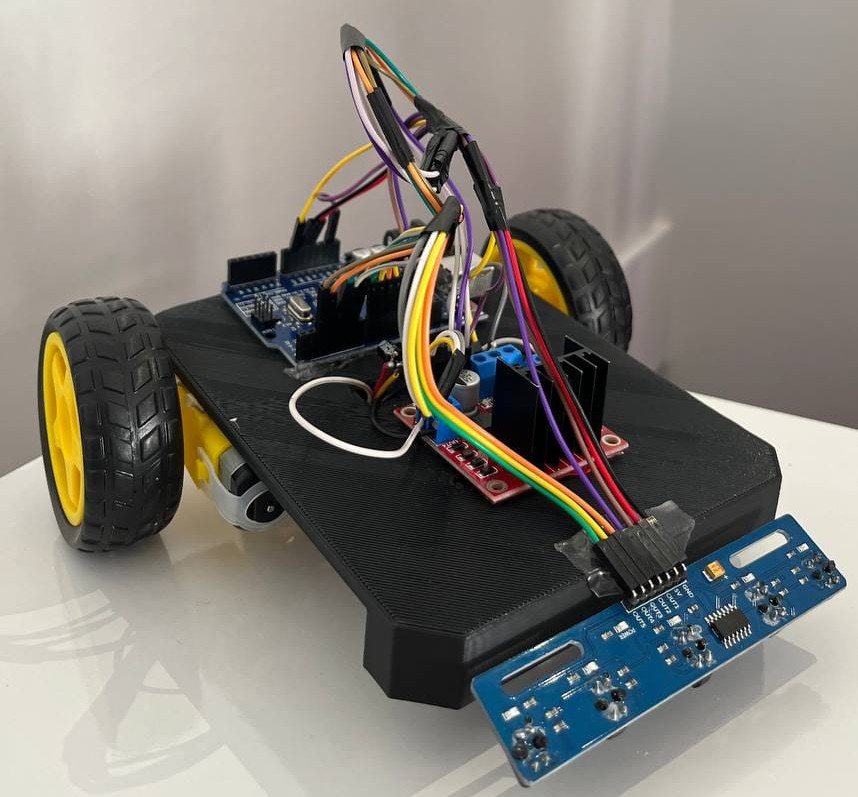

# Arduino Line Follower Robot | PD Control

<p align="center">
  
</p>

An Arduino-based, two-wheel line-following robot built with a five-channel digital infrared (IR) sensor array and an L298N motor driver. The project explores sensor-based navigation, differential motor control, and a proportional–derivative (PD) steering algorithm.

> **Project status:** A physical prototype was assembled and driven on a test track, but its tracking accuracy needed improvement. The current PD-control code is a revised version and **has not yet been validated on the physical robot**. The settings below are starting values, not measured optimal parameters.

## Features

- Five digital IR sensors detect the position of a dark line relative to the robot.
- Weighted sensor readings estimate lateral tracking error.
- PD steering adjusts the left and right motor speeds using PWM.
- On temporary line loss, the robot drives straight briefly and then pivots to search for the line.
- An all-black reading is treated as an intersection initially; if it persists beyond a configurable threshold, the robot stops.

## Hardware

| Component | Quantity | Purpose |
| --- | ---: | --- |
| Arduino-compatible controller (Uno/Nano pin mapping in code) | 1 | Reads sensors and controls motors |
| Five-channel digital IR line sensor array | 1 | Detects the track line |
| L298N dual H-bridge motor driver | 1 | Controls motor direction and speed |
| DC geared motors and wheels | 2 | Differential-drive movement |
| Robot chassis, wires, and suitable power supply | As needed | Mechanical assembly and electrical connections |

The exact controller model, battery specifications, and physical wiring should be verified against the original build before reuse.

## Pin Configuration

The following table documents the **pin assignments in the current code**, not independently verified physical wiring.

| Function | Arduino pin | L298N / sensor connection |
| --- | ---: | --- |
| Left motor direction 1 (`a1`) | D2 | IN1 (assumed) |
| Left motor direction 2 (`a2`) | D4 | IN2 (assumed) |
| Left motor PWM (`speed_A`) | D3 | ENA (assumed) |
| Right motor direction 1 (`b1`) | D5 | IN3 (assumed) |
| Right motor direction 2 (`b2`) | D6 | IN4 (assumed) |
| Right motor PWM (`speed_B`) | D11 | ENB (assumed) |
| IR sensor 1 (leftmost) | D12 | Digital output 1 |
| IR sensor 2 | D13 | Digital output 2 |
| IR sensor 3 (center) | D10 | Digital output 3 |
| IR sensor 4 | D9 | Digital output 4 |
| IR sensor 5 (rightmost) | D8 | Digital output 5 |

**Wiring notes:** Connect the Arduino and motor driver grounds together. Supply the motors using an appropriate power source and respect the voltage/current ratings of the motor driver and motors. If the L298N board has ENA/ENB jumpers fitted, remove them when driving those pins using Arduino PWM. Confirm sensor supply voltage and output logic before powering the circuit.

## How It Works

### 1. Detect the line

The sensor array is read from left to right with these weights:

```text
Sensor:   S1   S2   S3   S4   S5
Weight:   -4   -2    0   +2   +4
```

In the current sketch, a sensor reading of `LOW` indicates black. This depends on the sensor module and must be checked on the actual hardware.

When one or more sensors detect the line, the error is the average of their weights:

```text
error = sum(weights of active sensors) / number of active sensors
```

### 2. Apply PD steering

```text
correction = KP * error + KD * (error - previousError)
leftPWM    = BASE + correction
rightPWM   = BASE - correction
```

The motor functions constrain the commanded PWM magnitudes to 0–255. The proportional term responds to the line position; the derivative-like term responds to changes in the error. **The derivative term is not normalized by elapsed time**, so its behavior depends on loop timing.

### 3. Recover from line loss

If none of the five sensors detects black, the robot drives straight for `LOST_STRAIGHT_MS` and then pivots based on the sign of the last error. This is a heuristic for short track gaps; it is not guaranteed to recover from every turn or gap.

### 4. Detect a possible finish area

If all five sensors continuously report black for at least `FINISH_MS`, the robot stops indefinitely until reset. Shorter all-black detections are crossed by driving straight. A wide intersection can also trigger the stop, so this behavior must be calibrated for the track.

## Default Parameters

| Parameter | Value | Meaning |
| --- | ---: | --- |
| `LINE_LEVEL` | `LOW` | Sensor output interpreted as black |
| `BASE` | 150 | Base PWM command |
| `KP` | 18.0 | Proportional gain |
| `KD` | 25.0 | Error-change gain |
| `BRIDGE_BOOST` | 30 | Added PWM during initial line loss |
| `LOST_STRAIGHT_MS` | 250 ms | Initial straight-drive interval |
| `SEARCH_SPEED` | 120 | Pivot PWM command |
| `FINISH_MS` | 300 ms | Continuous all-black stop threshold |

These values require tuning on the real robot and track.

## Upload and Run

1. Install the [Arduino IDE](https://www.arduino.cc/en/software).
2. Open `Line_Follower_Robot.ino` in the IDE. If Arduino IDE requests a matching sketch folder, allow it to create one.
3. Select the appropriate Arduino board and serial port.
4. Confirm the wiring, motor directions, and whether `LOW` means black for the sensor module.
5. Upload the sketch and begin testing at a safe, low speed with the wheels clear of obstacles.
6. Tune `BASE`, `KP`, `KD`, line-loss timing, and finish detection for the actual track.

**Note:** The current sketch does not implement serial sensor diagnostics or automatic sensor calibration. Verify sensor readings separately if behavior is unexpected.

## Testing and Limitations

- **Previously tested:** The assembled robot moved on a physical track, but line-following precision was not consistently satisfactory.
- **Not yet tested:** This revised PD-control sketch has not been validated on the physical prototype.
- **Known limitations:** Sensor polarity and wiring are unverified; gain values are untuned; all-black detection may mistake a wide intersection for a finish; the last-error search heuristic may choose an unhelpful direction after a centered reading; the derivative-like term assumes reasonably consistent loop timing.

## Next Steps

- Verify motor polarity and sensor output levels on the original hardware.
- Tune PD gains and speed using repeatable track trials.
- Record performance on straight sections, curves, intersections, and gaps.
- Improve recovery and finish detection using test results.
- Add a short demonstration video once the revised version has been tested.

## Project Files

```text
Arduino-Line-Follower-Robot/
├── Line_Follower_Robot.ino
├── README.md
└── images/
    └── robot.jpg
```

## Author

Aya Aljard — Computer Engineering
